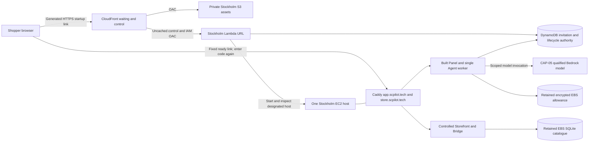

# CAP-04 deployment handoff

**23 October preparation update:** the current concrete candidate inventory and
ordered recovery are in [the inactive apply dossier](cap06-apply-proposal.md).
[The23October reconciliation](research/2026-10-23-cap06-inventory-reconciliation.md)
supersedes the historical budget-fit implications below. The old55.50+23=78.50
allocation arithmetic does not establish an USD80 fit. No resources, observation
service adoption, spending, DNS change or apply approval follows from either record.

**20 October 2026 — conditional preparation package; no deployment performed.**
The owner could not reach Billing Support and instructed us to continue with the
available evidence. Further preparation need not wait for that response. Public
IPv4 credit applicability remains unknown, and neither resource permissions nor
cloud operation are reported as verified. This continuation does not authorize a
Paid-plan upgrade, advanced features, an inference-budget increase or a billing
experiment. Local 02, final acceptance of 09 and parent CAP-04 remain open.

This consolidates the [approved Stockholm amendment](superpowers/specs/2026-10-19-cap04-stockholm-ingress-amendment.md),
[account evidence](cap04-account-feasibility.md) and existing local runbooks. It
supersedes the older supervised/shared-cart design brief as the execution handoff.

22 October observation update: the
[browser-independent Scheduler proposal](superpowers/specs/2026-10-22-cap06-observation-delivery-design.md)
and [current primary-source contract/costs](research/2026-10-22-cap06-observation-delivery-contract.md)
are ready for owner design review. They propose one schedule/group/scoped role,
one completion metric and two alarms, with USD23 additional planning allocation
(prior USD55.50 continuous reference plus allocation = USD78.50). This consumes
most of the proposed USD80 contingency; actual usage/eligibility and complete
cost reconciliation remain required. The
[inactive local tick and disabled bundle](cap06-observation-delivery.md) are now
prepared/tested under the owner's continuation. No resource, selected inventory
or spending authorization is changed; actual service adoption/apply still needs
the complete concrete review.

22 October preparation update: a pure
[CloudFront/Lambda access bundle](cap06-cloud-access.md) now expresses exact runtime
and origin permissions, header/cache settings and browser POST payload signing.
It is not a deployable stack or proof of effective AWS authorization. No resources
or policies were applied; final inventory/cost approval and cloud acceptance remain
required. Startup/controller Lambda invocation counts must enter the final estimate.

## Selected topology

The two shopping A records target one retained Elastic IP. Caddy terminates public
ACME HTTPS on the two owned names. CloudFront uses its generated certificate and
hostname for startup only, so Virginia ACM is not required. A stopped host cannot
answer shopping bookmarks; cold entry requires the startup link. There is no
always-on shopping proxy. Manual owner prewarming/start is the fallback; it does
not bypass admission or the safe idle-stop contract.

## Service and state inventory

| Component   | Selected scope                                                | Persistence and boundary                                                                    |
| ----------- | ------------------------------------------------------------- | ------------------------------------------------------------------------------------------- |
| EC2         | One candidate Linux t3.small, Standard CPU credits, Stockholm | One Agent worker; size remains subject to deployed measurement                              |
| EBS         | 20 GB encrypted gp3                                           | Catalogue, allowance and restricted host configuration survive stop/start and code rollback |
| Public IPv4 | One retained Elastic IP, direct public subnet/IGW             | Address remains billable while stopped; credit coverage unresolved                          |
| Caddy       | Public ports 80/443 for challenge/HTTPS; loopback upstreams   | Restricted persistent ACME account/certificate/key state, separate from releases            |
| S3          | Private release/catalogue-backup objects and waiting assets   | Private REST origin, OAC, explicit backup/object inventory; no public website bucket        |
| CloudFront  | Pay-as-you-go generated waiting hostname                      | Cache only public static assets; never cache invitation/control or personal responses       |
| Lambda      | Regional, outside VPC; AWS_IAM Function URL via OAC           | Short requests; no function waits for boot; only designated host control                    |
| DynamoDB    | Remote invitation/lifecycle coordination                      | Durable conditional authority across EC2 stops; no shared-filesystem cloud adapter          |
| Bedrock     | Exact CAP-05 qualified model and endpoint                     | Model access, token/rate accounting and qualification still required; no fallback provider  |
| Diagnostics | Bounded redacted local logs and budgeted CloudWatch usage     | Seven-day application diagnostic retention; do not enable raw model invocation logging      |
| DNS         | Existing registrar management for app/store                   | No Route53 zone; inspect actual records and delegation before writes                        |

No RDS, Redis, ALB, NAT gateway, interface endpoint, extra customer-managed KMS
key, Secrets Manager, ECR or CloudFront flat-rate subscription is selected. If an
implementation needs an additional paid service, revise the inventory and cost
before adopting it. The VPC screenshot does not establish default-VPC status or
permission to allocate resources.

The catalogue is durable; carts, fictional orders and Storefront interaction
authority are in memory. Storefront restart resets them. Agent-only restart
invalidates Agent task authority while a surviving Storefront retains its cart.
Refresh alone does not reset commerce. Never automatically replay an Action with
an uncertain outcome. See [release/recovery](cap04-release-recovery.md).

Persist the initialized inference ledger and its identity independently of code.
Missing, corrupt, incompatible, full or uncertain accounting refuses inference.
Code rollback and catalogue restore cannot restore an earlier allowance. Unknown
charges remain reserved. Remote invitation revocation, absolute testing windows
and cumulative quotas likewise cannot reset on restart or code rollback. Their
AWS persistence/migration must preserve these properties before exposure.

Keep certificate state until its names are retired; restrict keys to the service
and owner. Keep accounting and invitation authority for the complete demo and
reconciliation period, without quota-reset deletion. Catalogue backups contain
no allowance snapshot that may be restored as live accounting. At teardown retain
only the agreed sanitized evidence and required accounting, then remove dedicated
state and backup objects after reconciliation. No participant conversations or
codes are a deployment artifact.

## Trust, IAM and secret handling

1. The startup site validates invitations before wake. GET visits/status polling
   cannot start EC2. Codes use POST bodies, never URLs, logs or browser storage.
   Readiness offers only the fixed app origin. The Shopper re-enters the code
   there; startup authority cannot authorize a shopping Action.
2. Preserve separate host cookies, exact origin/source checks, CSRF and per-Shopper
   ownership. No wildcard CORS or shared-domain cookie workaround. Off-origin
   Agent navigation remains blocked; Sensitive Fields remain excluded; Guarded
   Mutations require fresh bound Confirmation; stale/duplicate Actions are refused.
3. Keep admin/deployment permissions separate from runtime identities. Before cloud
   adoption, restrict controller Start/Stop to the designated host as required by
   the command split; describe operations may need broader resource syntax but
   must not accept a browser-selected host. The Agent may not launch arbitrary
   instances or allocate addresses. Test the final IAM policies in CAP-06/07.
4. Use an EC2 role and SDK credential chain for Bedrock and required remote control
   access, with only the qualified model and named tables/objects. No long-lived
   AWS access key goes into source, images, browser builds or runtime.env. Require
   IMDSv2 and isolate metadata access from unintended service/browser paths.
5. S3 bucket policy and Lambda invoke permissions restrict CloudFront OAC to the
   chosen distribution. Function URL access uses AWS_IAM; never make the control
   endpoint anonymous to fix an eligibility failure. If that path is unavailable,
   stop automatic-wake adoption and assess the approved manual fallback.
6. Build from clean reviewed source with pinned dependencies. Keep service secrets
   and identities in restricted server configuration, outside artifacts and CLI
   values. Preserve the existing service-user/filesystem protections. Restrict
   administration separately; qualify the actual access method and any extra cost
   before provisioning. Do not expose application/private/test/reset ports.

## Cost and unresolved evidence

Use the [19 October rate snapshot and full assumptions](research/2026-10-19-cap04-network-cost-refresh.md),
not a new quote. Estimates cover 60 days, 20 GB gp3, a retained IPv4 address,
bounded storage/log/traffic/control requests and USD11 allocated to model use and
qualification. No earned activity rewards or assumed legacy free allowances are
deducted.

| Scenario                     |                      Direct shopping plus generated-host wake |
| ---------------------------- | ------------------------------------------------------------: |
| 120 running hours            |                                                      USD26.99 |
| 360 running hours            |                                                      USD32.18 |
| 1,440 running hours          |                                                      USD55.50 |
| Host stopped for all 60 days | USD10.544 EBS/IPv4 alone, plus retained storage/control usage |

The continuous estimate leaves USD24.50 inside the proposed USD80 planning
envelope, plus USD20 unallocated from the evidenced USD100 credit. These are not
an AWS billing cap or permission to spend. The inference ledger limits model
admission, not total AWS infrastructure/bot traffic. Alerts are delayed signals;
neither shutdown nor an application limit makes retained storage/address usage free.

Credit expires 7 October 2027, 15:41 UTC; Free-plan access ends 7 April 2027 under
the observed account state. The later date does not extend plan access. Preserve
the Free plan and USD0 cash constraint; never upgrade automatically.

Both VPC credit searches found no match although its Stockholm dashboard opens.
Public IPv4 uses VPC billing codes. The owner could not reach Support and accepts
continuing preparation without that determination; this is not confirmed credit
coverage or acceptance of cash charges. Retain the full IPv4 allowance. See the
[coverage finding](research/2026-10-19-cap04-ipv4-credit-coverage.md).

Other outstanding deployment checks are EC2/EBS/S3 and control-feature authority,
the administrative path, exact model entitlement, DNS conflicts/delegation, IAM,
and deployed TLS/capacity/lifecycle behavior. Do not replace these checks with a
passed local fixture. If the Free account denies a required action, stop that
action and reassess; do not enable advanced features or change plans.

## Execution sequence

1. **Prepare CAP-05 offline:** design the narrow Bedrock adapter against the
   existing LLMClient contract and allowance boundary, write mocked contract and
   failure tests, and specify bounded token receipts/pricing. No account credential
   is needed for this preparation. Leave live qualification pending.
2. **Qualify CAP-05 separately:** verify exact account/model/Region authority with
   the least consequential read-only method available. Obtain a concrete bounded
   paid-call authorization before inference; the old OpenRouter ceiling and the
   USD11 architecture allocation are not a Bedrock evaluation authorization.
   Keep the frozen corpus, strict schema/currency/safety and accuracy gates.
3. **Prepare CAP-06 locally:** version the infrastructure/configuration and remote
   authority implementation, preserve conditional lifecycle/admission transactions,
   use a separate public-ACME Caddy configuration and persistent certificate path,
   and validate policy/configuration offline. The current static evaluation
   Caddyfile cannot be deployed as public ACME configuration.
4. **Authorize and apply CAP-06:** present the exact resource/change inventory,
   costs, account constraints and rollback before AWS writes or DNS changes. Build
   Linux artifacts on Linux; verify manifest and schema against retained state.
   Initialize allowance and authority explicitly once. Record sanitized resource
   identities outside public evidence, image/toolchain versions and teardown date.
5. **Release:** back up/verify the catalogue, close admission and drain work, stop
   the designated supervisor, select the new verified artifact and start one
   worker. Retain current state and previous compatible code. Require public
   trusted app/store TLS, state readiness and full application health before ready.
6. **Rollback:** stop/drain again, verify old code against current state, select
   the prior compatible artifact, and restart. Do not roll back authority,
   certificate storage or spending history. If compatibility fails, remain closed
   for maintenance. Explain cart reset and check uncertain outcomes before retry.
7. **CAP-07 acceptance:** test physical Android Chrome and desktop Chrome/Edge on
   the actual domains, isolation, Confirmation/Undo, refresh/SSE/Stop, uncertain
   Actions and restarts, bounded overload/allowance refusal and host CPU/RAM. Test
   cold start, concurrent wake, revocation outside EC2, trusted-TLS readiness,
   genuine idle stop after 60 minutes, activity/drain races, control outage and
   manual prewarm. Never infer cloud throughput from local fake-model timing.
8. **Teardown after use:** close admission/disable inference, drain/stop, reconcile
   reservations, retain only approved evidence, disable startup/control, and remove
   dedicated resources in dependency order. Release EIP, remove dedicated DNS,
   check retained EBS/objects/logs/tables/roles and any distribution teardown steps.
   Never delete the existing shared VPC or unrelated resources. Verify tagged
   inventory and subsequent billing; stopping EC2 alone is not teardown.

## Evidence and handoff status

Local routing, invitation admission, durable allowance, release/restart, lifecycle
and combined-capacity tickets are resolved (01 and 03–08). The code verification
basis is 716 Python/browser tests and 199 TypeScript tests plus build/type/lint
checks; no runtime changes are made by this package. Physical Android evidence
uses disposable local certificate exceptions and does not prove public TLS.

Local 02 remains open with the accepted preparation exception; 09's package is
prepared for review, not fully accepted. Parent CAP-04 is not closed. The owner
has approved the chosen topology and continuing without a Support response,
not the newly assembled package's final acceptance or an AWS apply. Offline
preparation can proceed; paid qualification, provisioning and public acceptance
retain their separate authorization and evidence requirements.
