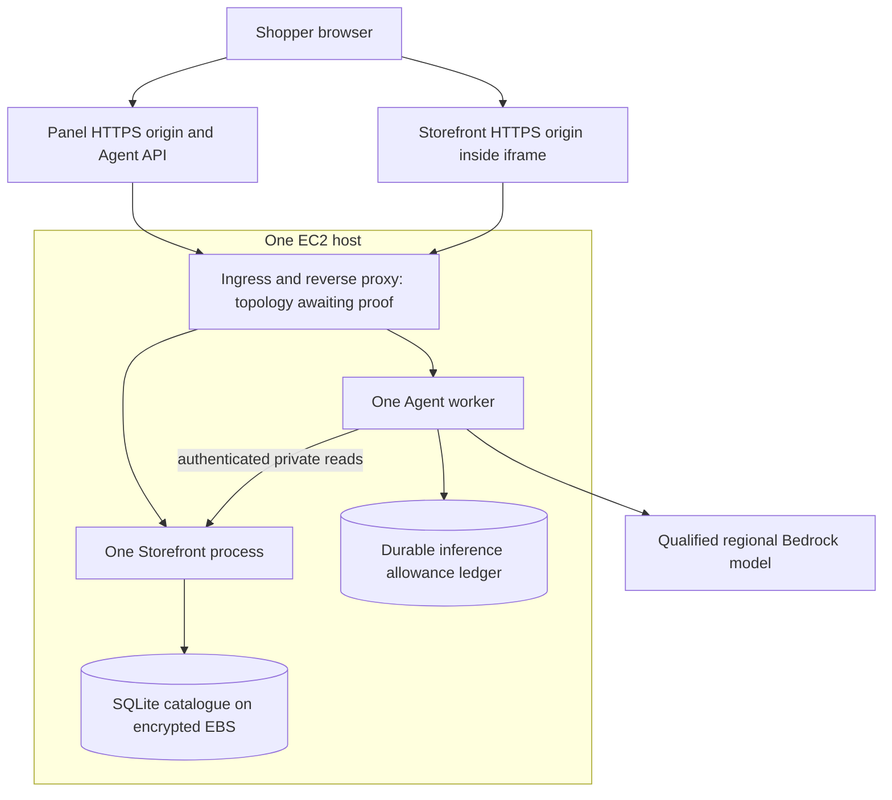

# CAP-04: credit-only cloud design revision

Date: 11 October 2026. Status: design revision for review; CAP-04 remains open.

## Approved intent and scope

The owner approved retaining one small EC2 host and SQLite while resolving public
HTTPS, shopper identity, persistence and spending controls before provisioning.
The goal is a shareable controlled-store demo for independent testers for roughly
two months, without a purchased domain or out-of-pocket AWS charges. Only the
owner and assistant are active contributors. This document grants no AWS resource
creation, account upgrade, provider subscription or model-spending authorization.

The last supplied account evidence is a Free account plan with $100 credit and a
7 April 2027 plan end date. It is not a current balance check. CAP-02/03 closed
under the approved synthetic benchmark scope; their results do not qualify Bedrock.

## Retained architecture

One host runs a production reverse proxy, built Panel/Bridge assets, one Storefront
process and one Agent worker. The Storefront alone opens the catalogue database;
the Agent reads through its authenticated private API. Browser-facing origins and
the private service URL must be independently configurable. Application ports stay
on loopback; only the selected proxy entry is reachable through the ingress design.
Use an EC2 role for narrowly scoped Bedrock access, not embedded AWS credentials.
Keep model interpretation and grounded advice separate from deterministic Action,
ownership and Confirmation guards. Experimental retrieval remains disabled.

The diagram describes logical routing, not an already selected network topology.
Two browser origins do not require two EC2 instances. Single-host downtime and
ephemeral shopping state remain explicit graduation-demo limitations.

## Public access: options and decision rule

| Option                                                                     | Benefit                                                          | Blocking issue / disposition                                                                                                                                    |
| -------------------------------------------------------------------------- | ---------------------------------------------------------------- | --------------------------------------------------------------------------------------------------------------------------------------------------------------- |
| Two standard pay-as-you-go CloudFront distributions with an EC2 VPC origin | Generated viewer HTTPS names, separate origins, no public origin | Leading candidate for investigation. Verify Free-plan eligibility, cross-site iframe identity, private-origin access, and a complete affordable outbound route. |
| Two distributions with a public EC2 HTTPS custom origin                    | Conventional HTTPS origin forwarding                             | Requires a trusted certificate for an origin hostname we control. No such hostname is available; not selected.                                                  |
| Owner-controlled same-site subdomains with direct proxy TLS                | Simpler strict-cookie behavior and fewer network components      | Requires a domain or suitable delegated names; conflicts with current assumptions. Only reconsider if those assumptions change.                                 |

CloudFront flat-rate plans are excluded: AWS documents that Free Tier accounts
cannot use them. Standard pay-as-you-go service pricing does not prove that this
specific Free account has access. Do not switch account plans to unlock it.
[AWS plan requirements](https://docs.aws.amazon.com/PricingPlanManager/latest/UserGuide/plans.html).

The VPC-origin candidate must explicitly price and verify outbound Bedrock access,
artifact delivery and maintenance. A private subnet does not get outbound access
just because CloudFront can reach it. Compare compatible IPv6 egress against the
necessary private endpoints; do not assume either covers all dependencies. A NAT
gateway, load balancer or public IPv4 is not silently included. Private AWS origin
connectivity is distinct from claiming application-layer TLS on every hop.
[AWS VPC origins](https://docs.aws.amazon.com/AmazonCloudFront/latest/DeveloperGuide/private-content-vpc-origins.html).

Two generated CloudFront hosts are cross-site. Current Storefront and Agent cookies
use SameSite=Strict; changing the hostnames alone is insufficient. Investigate a
partitioned Storefront cookie in the embedded context while keeping Agent authority
first-party. This is a proposed probe, not an approved cookie change. Test linking,
new tabs, refresh, identity expiry and top-level navigation before choosing it.
SameSite=None alone does not overcome third-party-cookie blocking. Do not remove
CSRF, exact-origin/source-window checks or HttpOnly to work around the issue.
See the [sourced entry review](../../research/2026-10-10-aws-public-entry-review.md).

Personal HTML, cart, identity, API and SSE routes require disabled caching, explicit
forwarding of necessary cookies/headers/query parameters, and zero reuse of
Set-Cookie between shoppers. Static versioned assets may be cached separately.
Verify the exact public Host/Origin mapping and prevent direct-origin bypass.
SSE needs prompt flushing, no proxy buffering, heartbeats within idle timeouts,
bounded reconnects and cursor forwarding. Reconnect must not replay shopping commands.

## Database, state and recovery

| State                                        | Storage / lifetime                                              | Recovery contract                                                                                                              |
| -------------------------------------------- | --------------------------------------------------------------- | ------------------------------------------------------------------------------------------------------------------------------ |
| Catalogue                                    | SQLite on encrypted EBS, outside disposable release directories | Versioned import/migrations; preserve across ordinary deployments; verify schema/revision before serving.                      |
| Cart, fictional orders and shopper authority | Storefront memory, existing ownership and expiry                | Storefront restart resets commerce and invalidates its generation; require fresh linking.                                      |
| Shopping Task and Agent authority            | Agent memory, existing ownership and expiry                     | Agent restart invalidates old authority; surviving Storefront cart remains.                                                    |
| Inference reservations and usage             | Separate durable transactional ledger                           | Restart/rollback must never reset allowance; uncertain charges retain reservations; missing/corrupt ledger disables inference. |

These restart directions preserve the implemented local contract. Do not introduce
the old coordinated wipe-everything policy or claim persistent carts. Never replay
an Action whose outcome is uncertain. See [shopper isolation evidence](../../shopper-isolation-verification.md).

The measured local catalogue was 110,592 bytes (108 KiB) on 10 October. This is a
measurement, not a size limit. SQLite shares the provisioned disk; no RDS service is
needed for this demo. Backups and any disk/compute expansion still need budgeting.
Use a consistent SQLite backup/export and verify restore on a disposable copy;
do not copy a changing database blindly or restore the allowance ledger to an older
balance. A rebuilt fictional catalogue must match the intended release revision.
[AWS EBS billing](https://aws.amazon.com/ebs/pricing/),
[SQLite deployment guidance](https://www.sqlite.org/whentouse.html).

## Admission, inference and operating cost

Publicly reachable does not mean unlimited inference. Proposed admission is
owner-issued expiring demo invitations, exchanged for server-side sessions without
placing invitation secrets in URLs or logs. Invitations must not replace shopper
ownership. Bound active shoppers, sessions, request size, request rate, output tokens,
repair count and model-call concurrency globally and per shopper. Choose concrete
limits from the capacity rehearsal before release; registry capacity is not a
measurement of safe concurrent use. New cookies must not bypass the global allowance.

Reserve a conservative cost before each model request, commit actual usage when
known, retain reservations on uncertain outcomes, and stop when the allowance cannot
cover another request. Cover advice and repairs as well as interpretation. Use a
durable kill switch and a bounded queue with an explicit busy response. No automatic
fallback to a paid external provider. Bedrock model selection and qualification
remain CAP-05 work.

The prior $40.35/60-day hosting subtotal included a public IPv4 and excluded the
public front door. It is a historical reference, not a quote for the VPC-origin
candidate. Recompute the bill of materials after selecting ingress and egress:
compute + EBS + applicable addresses/endpoints + delivery/transfer + logging/backup

- qualification/inference + contingency. Avoid double-counting retained storage.
  Propose an $80 eligible-credit envelope with $20 reserve only if the confirmed
  balance is still $100 and the final estimate fits; this is not spending approval.
  Keep the Free account plan and recheck actual credit applicability/expiry. Billing
  alerts supplement controls; they do not replace the application allowance.
  [Existing cost assumptions](../../cap04-credit-only-plan.md),
  [AWS account plans](https://docs.aws.amazon.com/awsaccountbilling/latest/aboutv2/free-tier-plans.html).

## Release, operations and acceptance

Build immutable assets before deployment. Keep service secrets and the catalogue
outside the release, with restricted permissions. Run as unprivileged services;
disable test/reset routes and development reloaders. Logs contain timings, bounded
identifiers and failure categories, not prompts, cookies, transcripts or secrets;
propose seven-day retention and a fixed disk-size ceiling. A release rollback must
check catalogue compatibility and preserve the latest spending ledger.

Before public use, record restart, disk-full, provider failure, backup/restore,
allowance exhaustion and teardown results. Teardown must inventory distributions,
origins, hosts, volumes, snapshots, addresses/endpoints and log storage, retaining
only authorized evidence. Stopping the host is not complete teardown.

| Gate             | Evidence required                                                                                                                           | Where verified                                                                       |
| ---------------- | ------------------------------------------------------------------------------------------------------------------------------------------- | ------------------------------------------------------------------------------------ |
| Browser boundary | Two unrelated HTTPS sites; separate shoppers; third-party cookies blocked; linking, refresh, mutations, Confirmation/Undo and SSE reconnect | Local browser/proxy rehearsal first; deployed candidate again in CAP-07              |
| Host capacity    | Representative concurrent shoppers, CPU/RAM, queue delay and memory exhaustion; measured safe limits                                        | Local measurements plus candidate-host qualification                                 |
| Money and access | Free-plan eligibility for every selected service, actual credit balance/applicability, regional model access and complete estimate          | Owner account evidence and official pricing; no inference as a read-only access test |
| Recovery         | Agent-only and Storefront-only restart, stale authority rejection, no uncertain Action replay, ledger continuity                            | Local regression and cloud acceptance                                                |
| Network          | Working model/maintenance egress, protected origin, cookie/header forwarding, no cross-shopper cache reuse                                  | Reviewed configuration plus actual cloud qualification                               |

CAP-04 can close only when topology, account feasibility, complete costing and the
implementation/acceptance design are reviewable and approved. Cloud acceptance
itself belongs to CAP-07. The next design probe is the cross-site browser identity
rehearsal; account eligibility and network costing can be investigated alongside it.
No infrastructure or application behavior was changed by this revision.
